# App Outline – Domains and Screens (draft)

Which parts the apps have and how screens connect. Stack-neutral: web or mobile is decision B1. Screen components (buttons, fields, layout) are left blank until the stack and Ecurious API are known. States refer to `state-machine.md`; tags as in `diagrams.md`:

- **Red dashed** = [GAP], **Orange** = [TEAM], **Green dashed** = [PROPOSAL]
- Phase: **S1** = needed for the mandatory full cycle, **G3** = edge cases, **Stretch** = only after G3

Low-fi wireframes: images in §6 (render on GitHub). Editable source: Claude Design canvas, private until shared: https://claude.ai/artifact/B9xqDpmNXaKHuCeBcx6ZVb

## 1. Apps

| App | User | Purpose | Phase |
|---|---|---|---|
| Driver app | Driver | Find bay, reserve, check in, charge, handle problems | S1 |
| Operator view | CPO / operator staff | Escalations, alerts, fault tickets, bay flags; KPIs | G3 |
| Partner page | App B / partner | Shows our webhooks arriving live; or a second client using our API [TEAM B8] | Stretch |

Driver app: design for a phone screen first, even if it is a web app; the driver uses it at the bay.

## 2. Driver app – screen flow

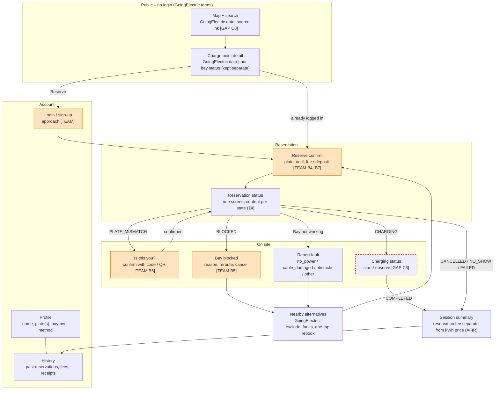

## 3. Domains

One row per domain. "Screen components" stays blank until B1 is decided.

| Domain | Screens | Data shown / entered | Backend calls (ours) | Phase | Open items | Screen components |
|---|---|---|---|---|---|---|
| Map and search | Map, charge point detail | GoingElectric locations, plugs, power, faults; our bay status for the test bay | none for GoingElectric (client fetches); bay status from us | S1 | C8 (key, web app, `ge_id` of test bay) | |
| Favourites | Star on charge point detail, "Favourites" list on map | GoingElectric station ID (`ge_id`) + user label only, stored on the device; station data fetched fresh on open | none (no login, nothing on our server) | Stretch | C8 question 5 (may we store the ID?); cross-device sync only with real login | |
| Login and identity | Login / sign-up | Driver identity linked to plate | login / session | S1 (minimal) | Login approach [TEAM]; needed because check-in matches plate to driver | |
| Profile | Profile | Name, plate(s), payment method | get / update profile | S1 (plate only) | Several plates per driver? [TEAM B6]; consent text (GDPR) | |
| Payment and deposit | Inside reserve confirm, summary, history | Fee or deposit amount, hold / release / capture / refund | ledger read (see `state-machine.md` "Payment ledger") | Stretch (mock ledger) | Amounts, late cancel, deposit credited? [TEAM B4, B7] | |
| Reservation | Reserve confirm, reservation status | Bay, plate, until, countdown, state message | create, cancel, get status | S1 | Grace period, reminder [TEAM B4]; push or in-app only | |
| Check-in | Reservation status, "Is this you?" | Match result, fallback code / QR | confirm check-in | S1 (match), G3 (mismatch, fallback) | C4, C5; fallback method [TEAM B6] | |
| Blocked bay and reroute | Bay blocked, nearby alternatives | `blocked_reason`, alternatives from GoingElectric | cancel, rebook | G3 | B5, C11 | |
| Fault report | Report fault | `fault_reason` | report fault | G3 | Faults during `CHARGING`? [TEAM] | |
| Charging | Charging status | Started / stopped, duration; kWh only if Ecurious provides it | get status | S1 | C3 | |
| History and receipts | History, session summary | Past reservations, fees with reason | list reservations, ledger | Stretch | Retention period (GDPR) [TEAM B6] | |
| Notifications | none (banner / push) | Reminder, state changes | — | G3 | In-app banner first; push only if time [TEAM] | |

## 4. Reservation status screen – content per state

One screen, the message and buttons change with the state. Covers driver UX when something fails.

| State | Driver sees | Actions |
|---|---|---|
| `REQUESTED` | "Reserving…" | — |
| `RESERVED` | Bay held, countdown to grace end, address | Navigate, Cancel, Bay not working |
| `PLATE_MISMATCH` | "A car with another plate arrived. Is this you?" | Yes (code / QR), No |
| `BLOCKED` | "Your bay is occupied" + reason if known | See alternatives, Cancel (no fee), wait |
| `UNVERIFIED` | "Bay status cannot be confirmed right now" (never "free") | See alternatives, Cancel (no fee) |
| `ARRIVED` | "Checked in – plug in to start" | Bay not working |
| `CHARGING` | Charging running, duration | — (stop is on the charger [GAP C3]) |
| `COMPLETED` | Summary | View receipt |
| `CANCELLED` | Cancelled, fee rule result | Reserve again |
| `NO_SHOW` | Reservation expired, fee result [TEAM B4] | Reserve again |
| `FAILED` | Reason (bay taken, server error) | Try other bay |
| `FAULT_REPORTED` | "Thanks – bay reported, no fee" | See alternatives |

## 5. Operator view

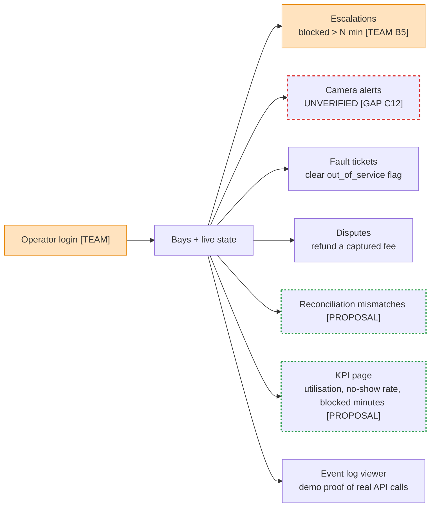

| Domain | Purpose | Phase | Open items | Screen components |
|---|---|---|---|---|
| Bays + live state | One row per bay: reservation state, camera last seen, `out_of_service` | G3 | — | |
| Escalations | Blocked bays waiting for action | G3 | B5 | |
| Camera alerts | Bays in `UNVERIFIED` | G3 | C12 | |
| Fault tickets | Driver fault reports; clear the bay flag | G3 | Who clears the flag [TEAM]; Ecurious back office? [GAP C13] | |
| Disputes | Refund a no-show fee | Stretch | Needs ledger | |
| Event log viewer | Every adapter call and state change | G1 | Plates masked? [TEAM B6] | |
| KPI page | Utilisation story for the pitch | Stretch | Label numbers as assumptions | |

Simplest version for the demo: the operator view is one page with these sections, no separate login.

## 6. Wireframes

Static exports of the design canvas (`wireframes/`). Grey dashed = component not decided; red dashed = [GAP]; orange = [TEAM]; green dashed = [PROPOSAL]. Re-export after canvas changes.

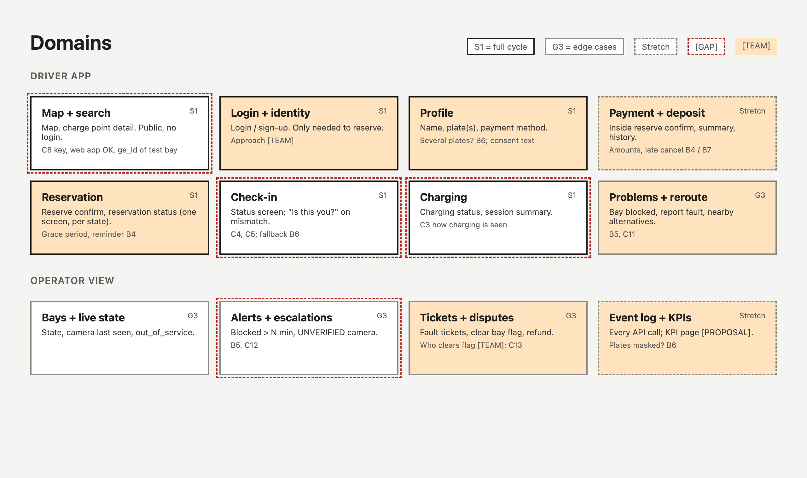

**Public and account**

| Map + search | Charge point detail | Login | Profile + history |
|---|---|---|---|
| 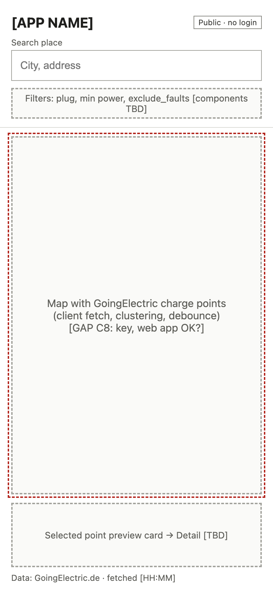 | 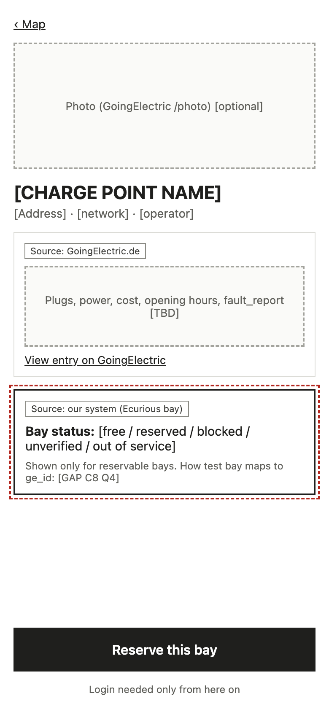 | 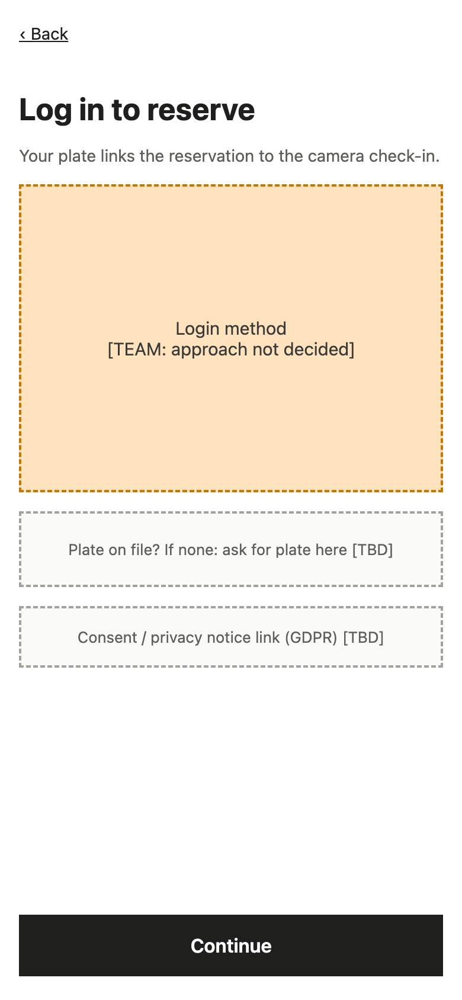 | 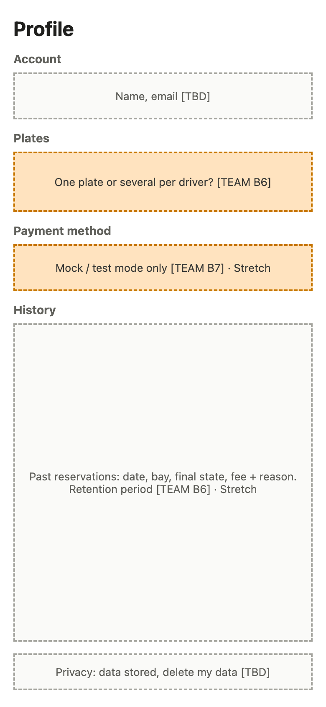 |

**Reservation cycle (S1)**

| Reserve confirm | Reservation status (`RESERVED`; other states: §4) | Charging | Session summary |
|---|---|---|---|
| 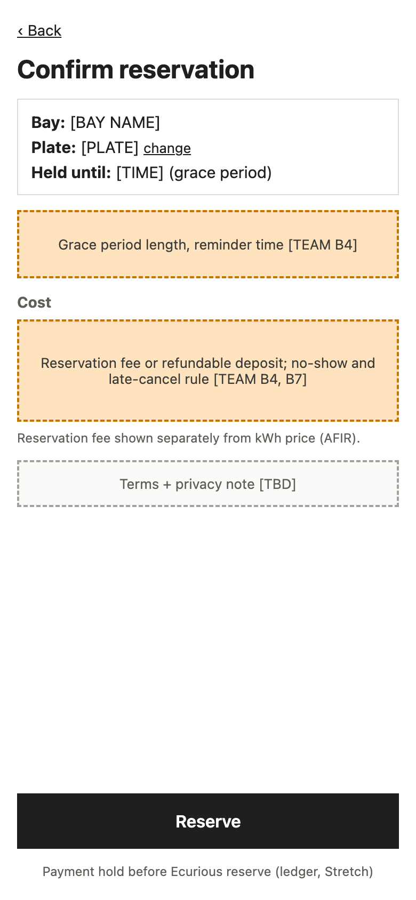 | 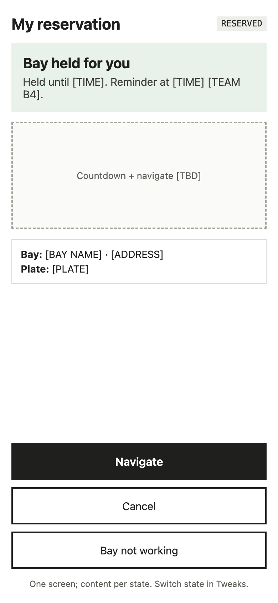 | 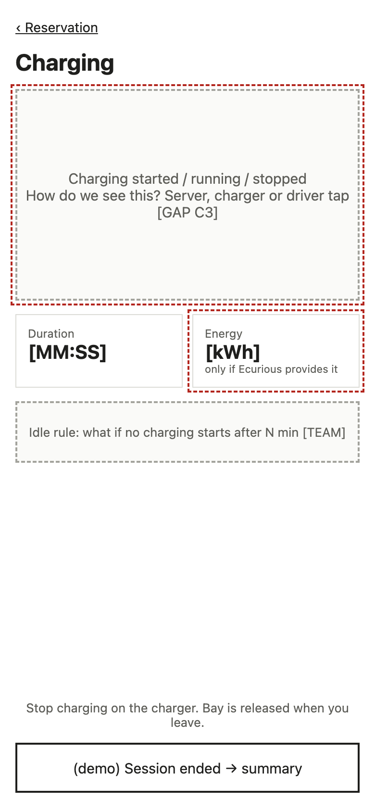 | 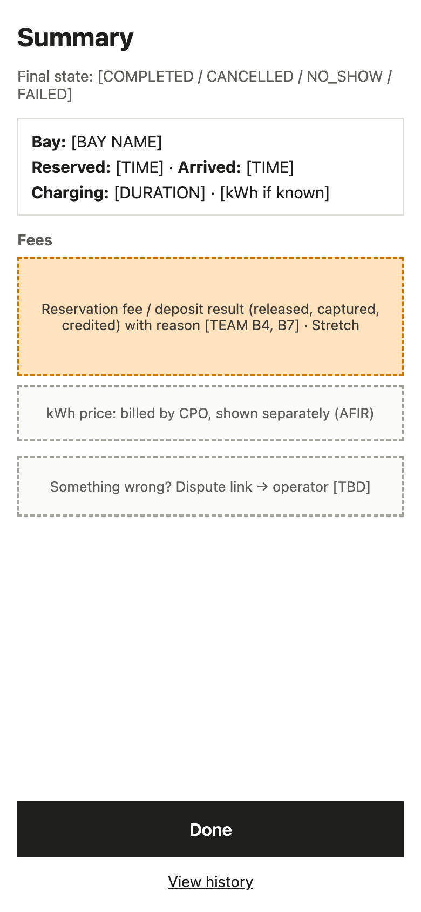 |

**On-site problems (G3)**

| Is this you? | Bay blocked + alternatives | Report fault |
|---|---|---|
| 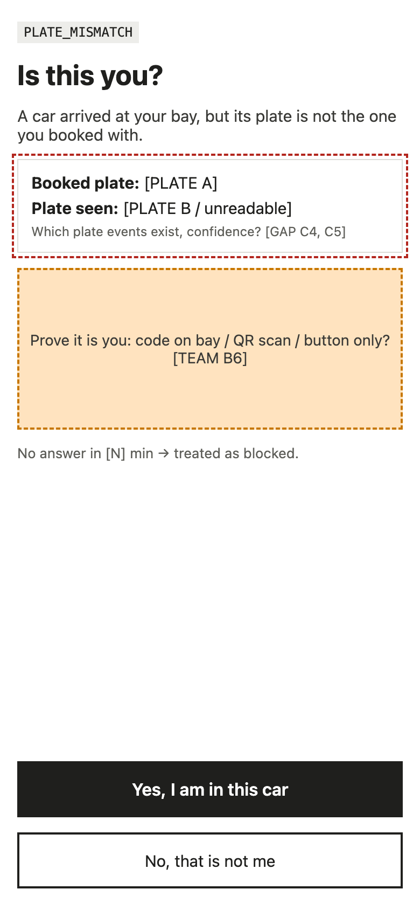 | 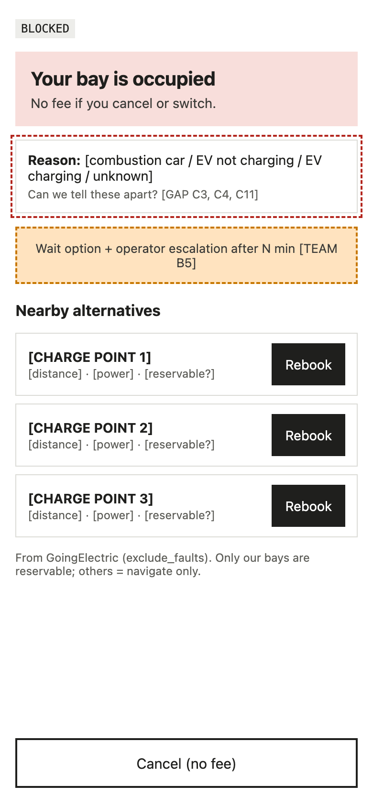 | 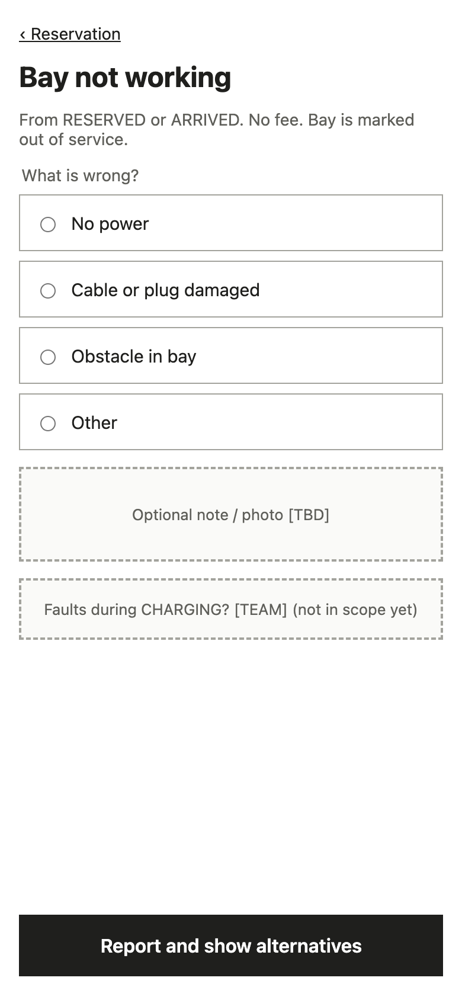 |

**Operator view (G3)**

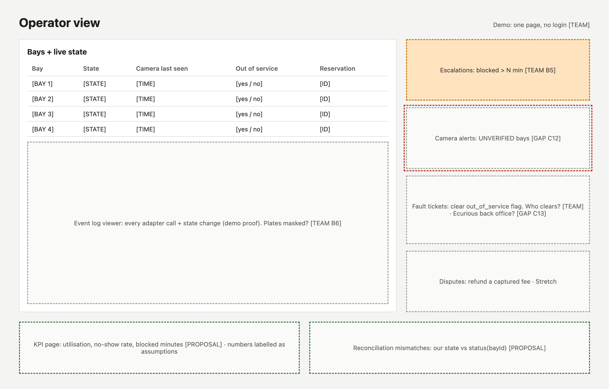
