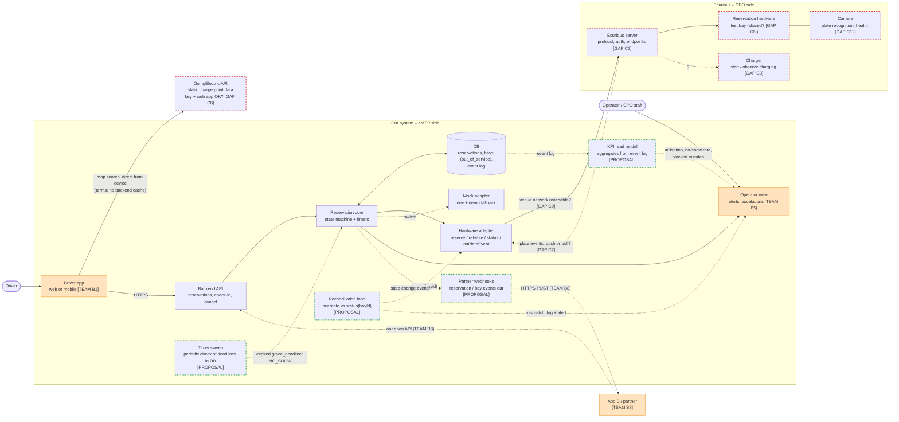
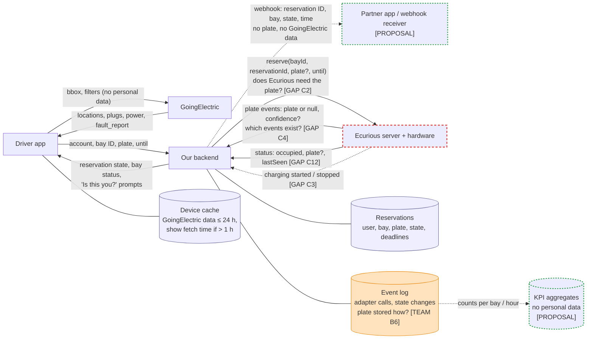
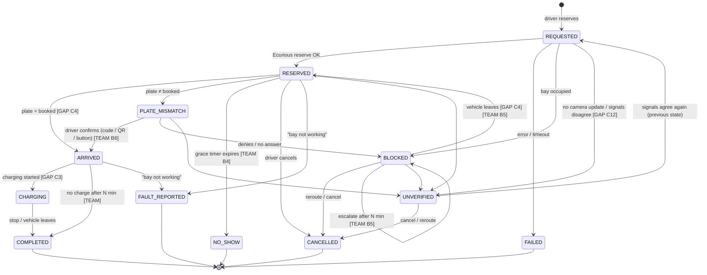
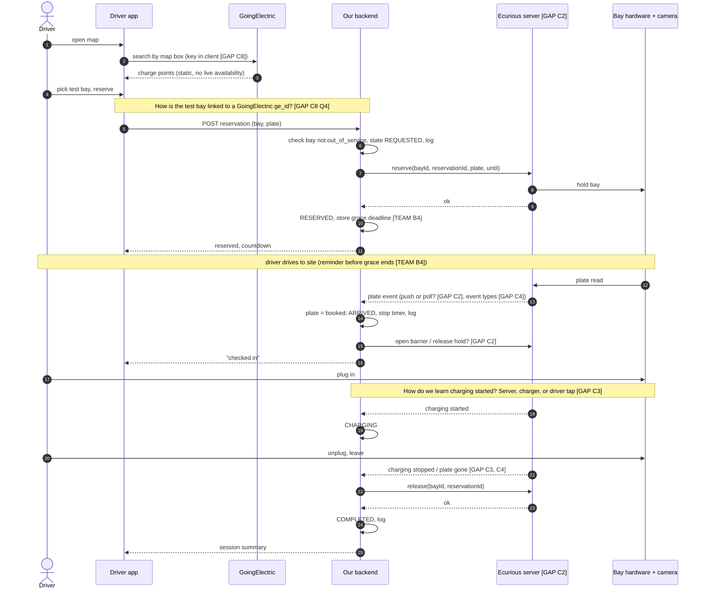
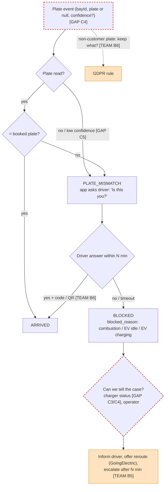

# Architecture and Data Flow Diagrams (draft)

Rough first version, before Ecurious API docs and team decisions. Mermaid, renders on GitHub. Sources: `state-machine.md`, `goingelectric.md`, `test-scenarios.md`, `../prep-plan.md`.

Legend, used in every diagram:

- **Red dashed** = [GAP] – unknown until Ecurious / GoingElectric / organiser answers (C-items in `prep-plan.md`)
- **Orange** = [TEAM] – team has not decided yet (B-items)
- **Green dashed** = [PROPOSAL] – extra design idea, not yet discussed with the team (see "Proposed additions" below)
- Plain = draft from the shared design docs, no open question

Replace each tag when the item is answered; update the gap table at the end.

## 1. Components (who talks to whom)

Notes:

- Map data never passes our backend (GoingElectric terms). Our bay status (Ecurious) is shown separately from GoingElectric data.
- Core does not know Ecurious directly; only the adapter does. Real adapter is built on site once C2 is answered; mock first.
- Timers live in our backend, not on the Ecurious server (proposal in `state-machine.md`).
- Green dashed boxes: see "Proposed additions" below.
- Only what the demo needs is drawn. Full-system parts we leave out (real payments, push, identity provider, CRM, store release …): `stack-options.md` "Out of scope".

## 2. Data flows (what data goes where)

GDPR points on this flow (values = decision B6, see `../templates/documentation.md` §8):

- Plates of non-customers arrive in plate events. Decide what we keep: nothing, match result only, or hashed plate (hash = pseudonymised, not anonymous).
- Plate leaves our system only if Ecurious needs it for `reserve` [GAP C2].
- No personal data goes to GoingElectric; no GoingElectric data goes out through our API (terms).
- Location / GPS: only if we build ETA-based no-show detection [TEAM B4].
- Webhooks [PROPOSAL] carry reservation ID and state only; KPI aggregates hold counts, no personal data.

## 3. Reservation states

Visual of the transition table in `state-machine.md`. Table wins if they differ.

`UNVERIFIED` returns to whichever state it came from; the diagram shows only one return arrow to stay readable.

## 4. Full cycle sequence (S1 happy path)

The mandatory live cycle: reserve → arrive → charge → release.

## 5. Plate event handling (S4, S7, S8)

What the backend does with any plate event while a reservation is `RESERVED`.

Key point for the pitch: the camera cannot tell "driver came in another car" from "stranger in my bay". Only the app can, by asking. Hence `PLATE_MISMATCH` before `BLOCKED`.

## Proposed additions [PROPOSAL]

Not yet discussed with the team. Each is small and fits the backend we already plan; drop any that do not fit the stack (B1).

| Proposal | What it does | Why | Diagram |
|---|---|---|---|
| Timer sweep | Store `grace_deadline` in the DB; a periodic job moves expired reservations to `NO_SHOW` | In-memory timers vanish on restart and leave bays held forever | 1 |
| Reconciliation loop | Every N s, compare our state with `status(bayId)`; log mismatches, alert operator | Hardware is source of truth; catches missed plate events [GAP C2 push/poll] | 1 |
| Partner webhooks | Push `reservation.reserved`, `reservation.no_show`, `bay.blocked` to a partner URL (or webhook.site in the demo) | Live interoperability proof for B8 without building a second app | 1, 2 |
| KPI read model | Build utilisation, no-show rate, blocked minutes from the event log | Utilisation and Business Case answers with real numbers from the demo | 1, 2 |

## Open items shown above

| Tag | Where it appears | What changes when answered |
|---|---|---|
| C2 Ecurious API | 1, 2, 4 | Real adapter, push vs poll, barrier call, whether plate is sent on `reserve` |
| C3 Charge step | 1, 2, 3, 4, 5 | `ARRIVED → CHARGING` trigger; blocked sub-case detection |
| C4 Plate events | 2, 3, 4, 5 | Mismatch, blocked, "vehicle leaves" transitions |
| C5 Plate testing | 5 | Low-confidence branch, S8 demo |
| C6 Shared test bay | 1 | Hardware time slots, more work on mock |
| C8 GoingElectric | 1, 4 | Web vs mobile (B1), key in client, bay ↔ `ge_id` mapping |
| C9 Venue network | 1 | Hosting, tunnel for webhooks |
| C12 Camera health | 1, 2, 3 | `UNVERIFIED` trigger beyond our own timeout |
| B1 Stack | 1 | App type, component technology column in docs |
| B4 No-show rules | 2, 3, 4 | Grace deadline, reminder, fee |
| B5 Blocked policy | 1, 3, 5 | Escalation, operator view |
| B6 Plate policy | 2, 3, 5 | Fallback check-in, what plate data is stored |
| B8 Interop depth | 1 | App B arrow: build or pitch only |
