# Happy flow: book a time slot, charge, pay

Screens of the running app, one per driver action, recorded 2026-10-24 on branch `feature/charging-screens` (PRs #57 time slots, #58 charging). The ring marks where the driver taps next. Same stills as the 45 s demo video.

Recorded with `ADAPTER=mock`: steps 1–8 behave the same on the real Ecurious lock; steps 9–13 need a simulated plate read and a simulated charger (no charging API yet [GAP C3]). Prices are example values [TEAM B4, B7].

| 1 Map | 2 Time slots | 3 Pick slot | 4 Log in |
|---|---|---|---|
| 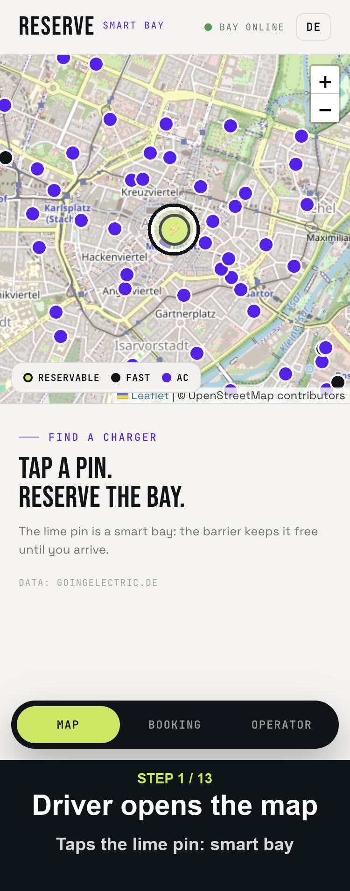 | 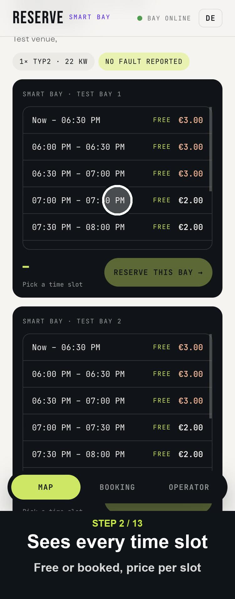 | 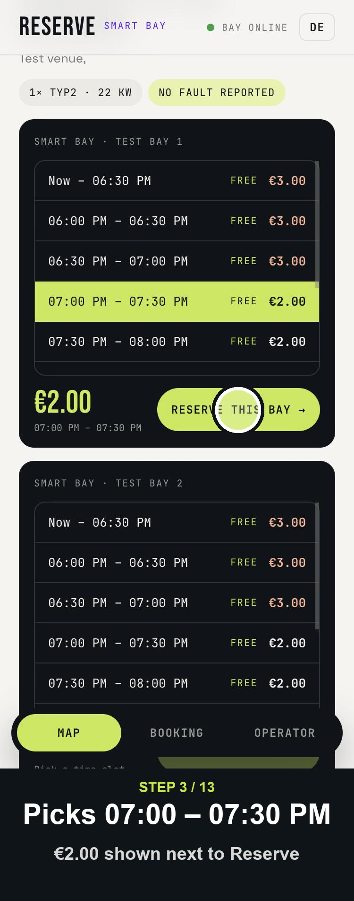 | 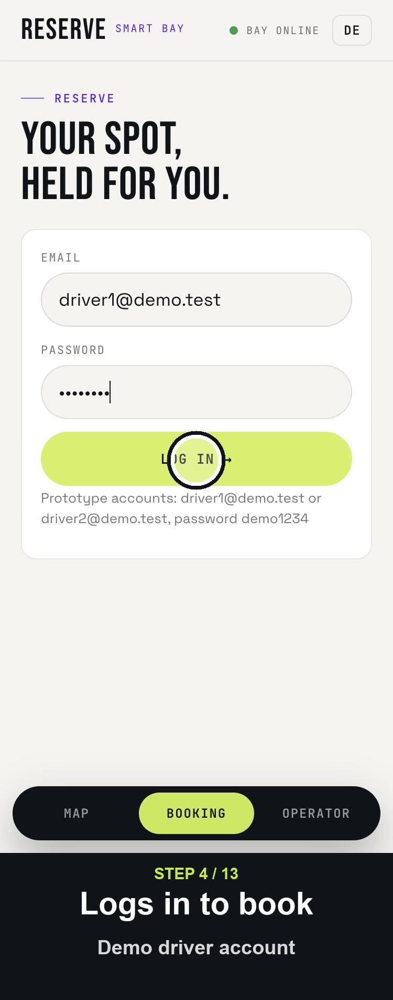 |

| 5 Confirm | 6 Slot booked | 7 Cancelled | 8 Book now |
|---|---|---|---|
| 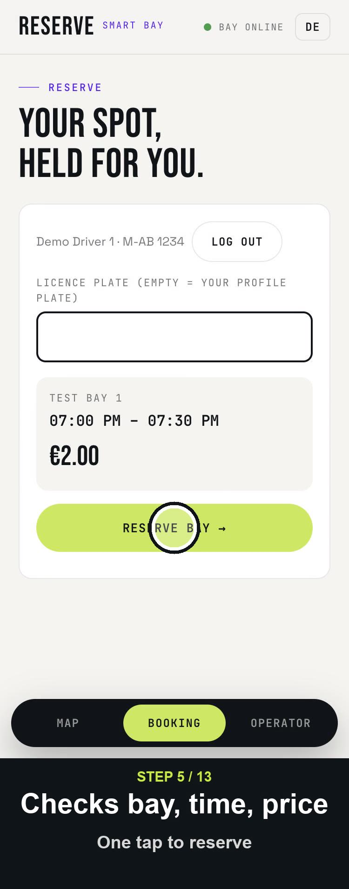 | 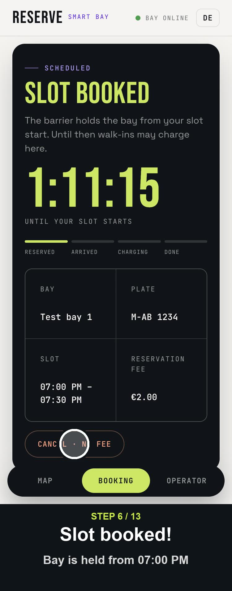 | 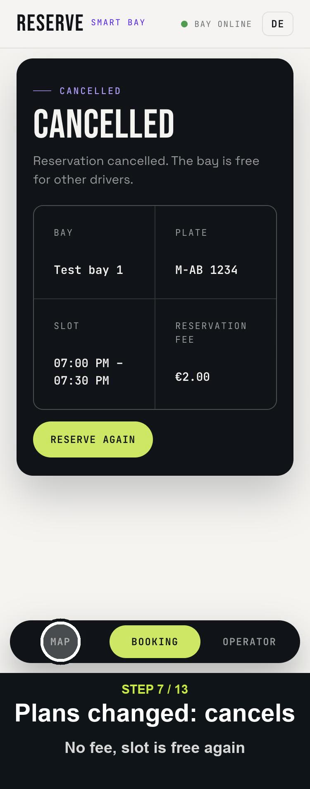 | 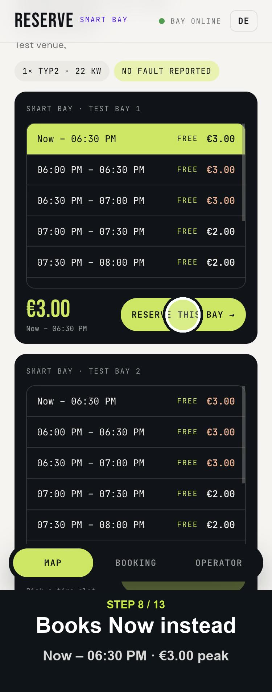 |

| 9 Bay held | 10 Car arrives | 11 Charging | 12 Stop | 13 Summary |
|---|---|---|---|---|
| 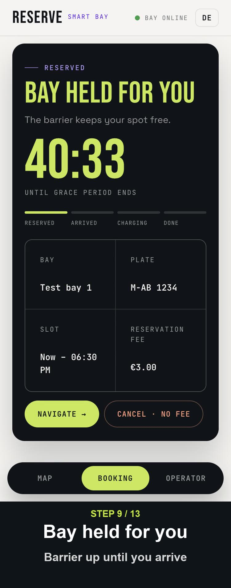 | 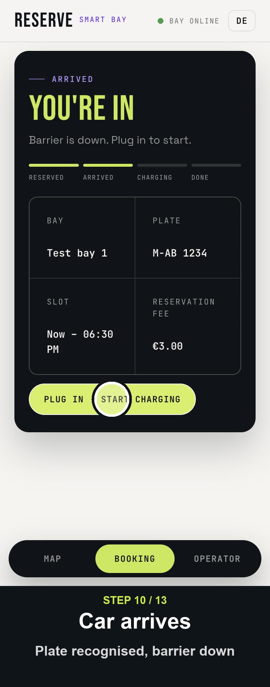 | 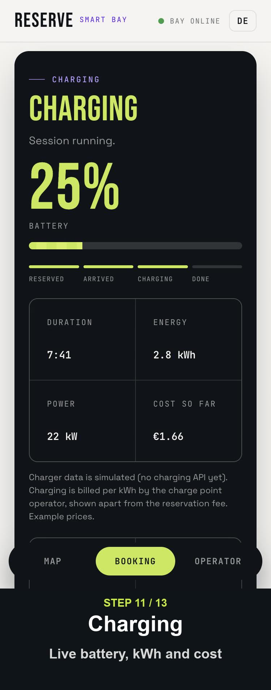 | 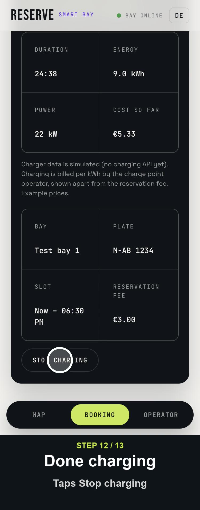 | 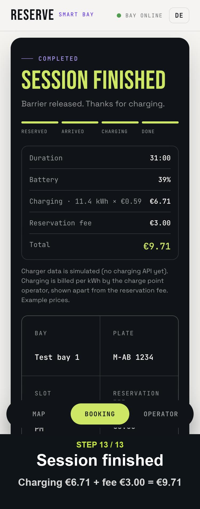 |

| Step | Driver does | State after | Backend call |
|---|---|---|---|
| 1–3 | Taps pin, picks 07:00–07:30 PM | – | `GET /api/bays`, `GET /api/bays/:id/slots` |
| 4 | Logs in (seeded demo account) | – | `POST /api/login` |
| 5–6 | Reserves the slot | `SCHEDULED` (no hardware hold until slot start) | `POST /api/reservations` with `slotStart` |
| 7 | Cancels | `CANCELLED`, no hardware call | `POST /api/reservations/:id/cancel` |
| 8–9 | Books "Now" | `RESERVED`, barrier up | `POST /api/reservations` without `slotStart` |
| 10 | Arrives; camera reads booked plate | `ARRIVED`, barrier down | hardware event (simulated) |
| 11–12 | Plugs in, later stops | `CHARGING` → `COMPLETED`, barrier released | `POST /api/reservations/:id/charging` |
| 13 | Sees summary: kWh × price + reservation fee (shown apart, AFIR) | `COMPLETED` | – |

Known gap: between 7 and 8, the booking tab still shows the cancelled booking until the driver taps "Reserve again"; the recording skips that screen.
